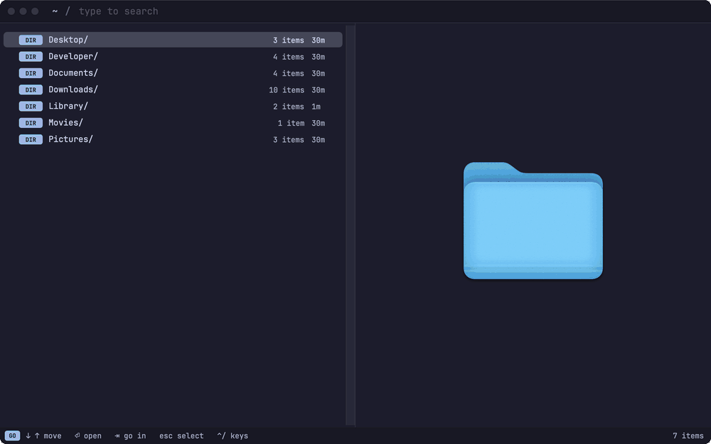
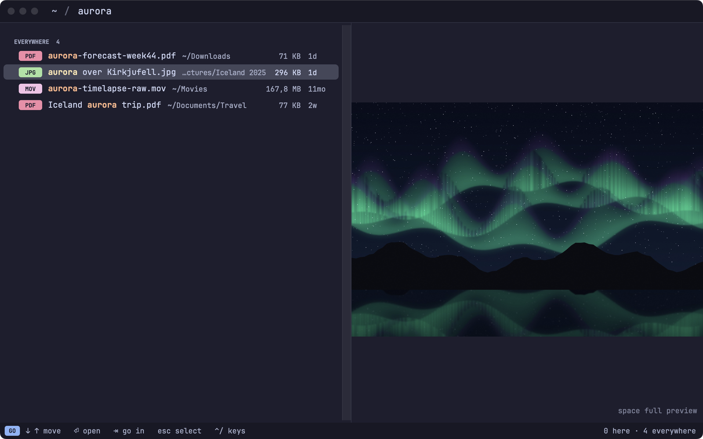
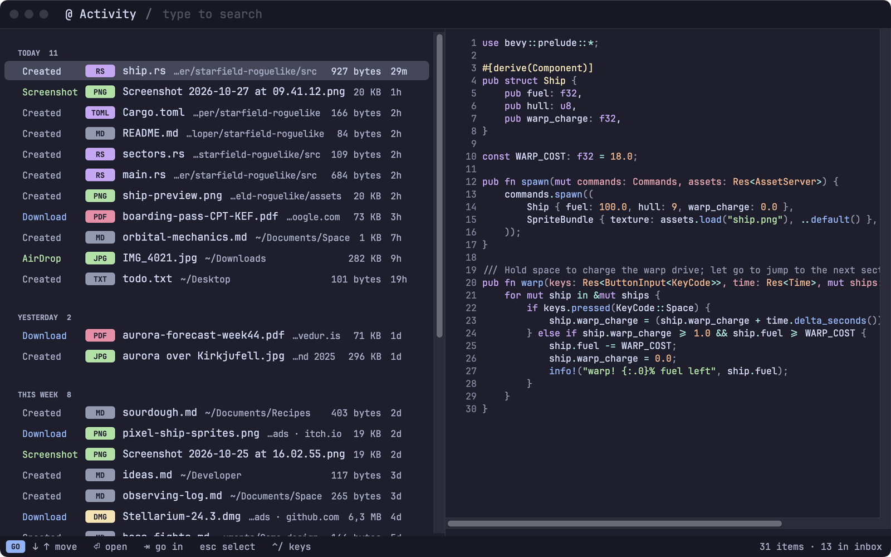
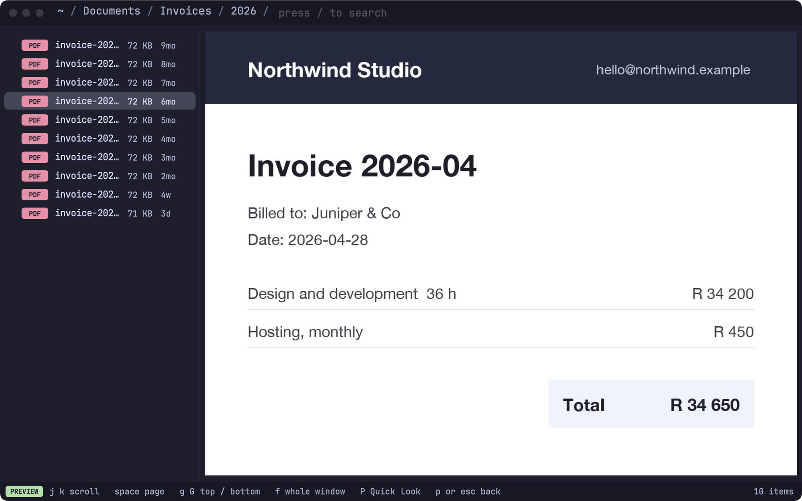
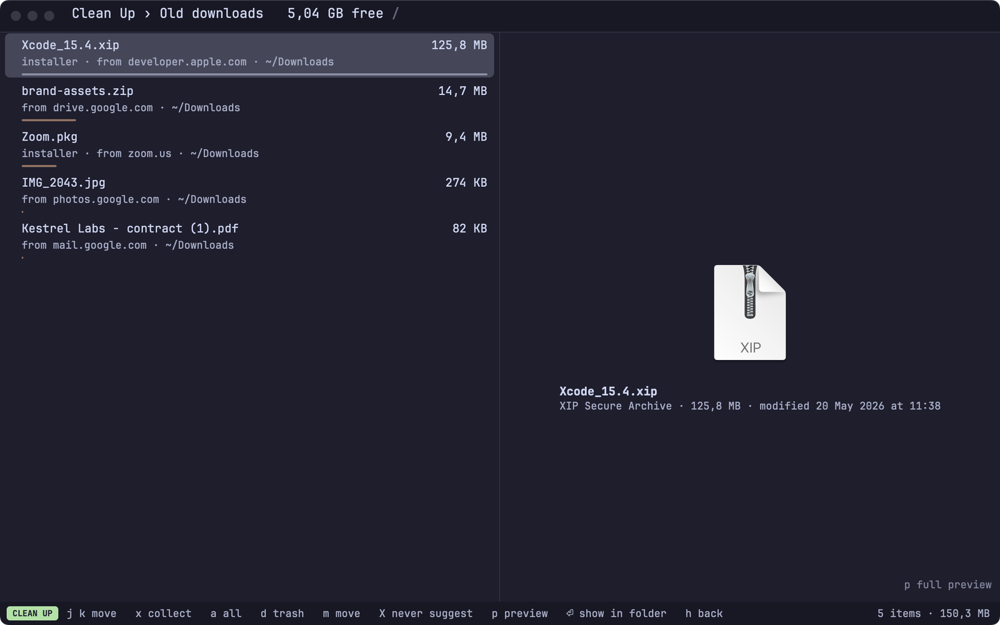

<p align="center">
  
</p>

<h1 align="center">Tilde</h1>

<p align="center">
  A fast, keyboard-first file navigator for macOS.<br>
  Type to go anywhere, act with single keys, undo everything.
</p>

<p align="center">
  <a href="https://github.com/tevans2/tilde/releases/latest"></a>
  <a href="https://github.com/tevans2/tilde/actions/workflows/ci.yml"></a>
  
  <a href="LICENSE"></a>
</p>

<p align="center">
  
</p>

## Why Tilde

- **Type to go anywhere.** The bar searches the open folder and your whole home folder at
  once. The folders you actually use come first, including the ones you `cd` into in the
  terminal (via [zoxide](https://github.com/ajeetdsouza/zoxide), if you have it).
- **Single keys, Vim-style.** `j` `k` to move, `h` `l` to go out and in, `m` to move,
  `c` to copy, `d` to trash, `r` to rename. Collect files from anywhere on a shelf with `x`, then
  act on all of them at once.
- **Undo everything.** Every operation is undoable, even after a restart. History (`H`)
  shows an undo tree you can go back to any point of.
- **Edit a folder as text.** `e` turns the folder into lines. Edit names to rename, delete
  lines to trash, type paths to move. Works in your own Neovim too.
- **See what's new.** `@` lists recent downloads, screenshots, AirDrops and edits, with
  where each came from.
- **Free up space.** `C` finds big files you haven't opened, old downloads, duplicates,
  build output in idle projects and app caches, and checks each one again before anything
  goes to the Trash.
- **Fast.** A Rust core, an index kept up to date live, and instant previews.

## A look around

| | |
|---|---|
| **Search here and everywhere**, the folders you use first | **Activity**: downloads with their sites, screenshots, AirDrops, edits |
| <picture>  <source media="(prefers-color-scheme: light)" srcset="docs/images/search-light.png">  </picture> | <picture>  <source media="(prefers-color-scheme: light)" srcset="docs/images/activity-light.png">  </picture> |
| **Preview mode** (`p`): the full preview, scrolled with `j` `k` | **Clean Up** (`C`): old downloads, with the site each came from |
| <picture>  <source media="(prefers-color-scheme: light)" srcset="docs/images/preview-light.png">  </picture> | <picture>  <source media="(prefers-color-scheme: light)" srcset="docs/images/cleanup-light.png">  </picture> |

## Install

Requires macOS 14 (Sonoma) or later, on Apple silicon or Intel.

```sh
curl -fsSL https://raw.githubusercontent.com/tevans2/tilde/main/scripts/get.sh | bash
```

This installs the latest release into `~/Applications`. Run it again to update.
Permissions such as Full Disk Access carry over between updates.

Or download **Tilde.dmg** from the [latest release](https://github.com/tevans2/tilde/releases/latest)
and drag Tilde to Applications. Tilde isn't notarized by Apple yet, so macOS blocks the
first launch of a copy downloaded in a browser. To allow it, open **System Settings ›
Privacy & Security** and click **Open Anyway**. The install command above avoids this.

To build from source instead, see [CONTRIBUTING.md](CONTRIBUTING.md).

**Uninstall:** quit Tilde, then delete `Tilde.app`. To also remove its settings, index and
permissions, run [`scripts/uninstall.sh`](scripts/uninstall.sh) from a clone.

## Getting started

On first launch, a welcome window walks you through Full Disk Access (so search can see
everything), the folder permissions and the editor for EDIT. Then:

| Mode | What it's for | Keys |
|---|---|---|
| **GO** (the bar) | Typing searches | `⏎` open · `tab` go into a folder · `⌫` on an empty bar goes up · `~` home · `@` Activity · `esc` → SELECT |
| **SELECT** (the list) | Acting on files | `j` `k` move · `h` `l` out / in · `x` shelf · `m` move · `c` copy · `d` trash · `r` rename · `e` EDIT · `p` preview · `u` undo · `/` → GO |
| Anywhere | | `⌃o` / `⌃i` back / forward · `⌘,` Settings · `⌘N` new window |

Every key can be changed in Settings › Keys.

- **[The guide](docs/GUIDE.md)** covers every key and feature.
- **[Configuration](docs/CONFIG.md)** covers the config file, themes and keymaps.
- **[Changelog](CHANGELOG.md)** lists what changed in each release.

## Contributing

Bug reports and ideas are welcome: [open an issue](https://github.com/tevans2/tilde/issues/new/choose).
Building, testing and releasing are covered in [CONTRIBUTING.md](CONTRIBUTING.md). The
design and build plan is in [docs/SPEC.md](docs/SPEC.md).

## License

[MIT](LICENSE). Maths in Markdown previews is typeset with [KaTeX](https://katex.org)
(MIT), bundled in `App/Sources/Tilde/Resources/katex`.
