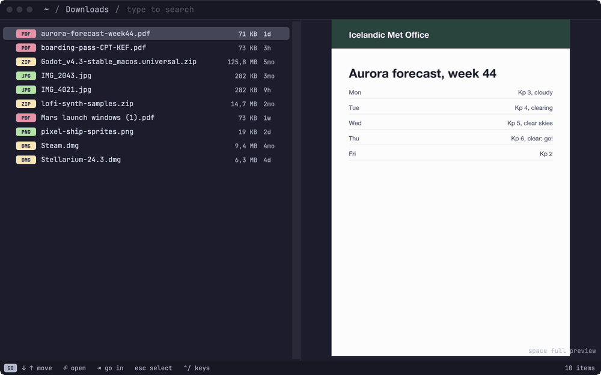
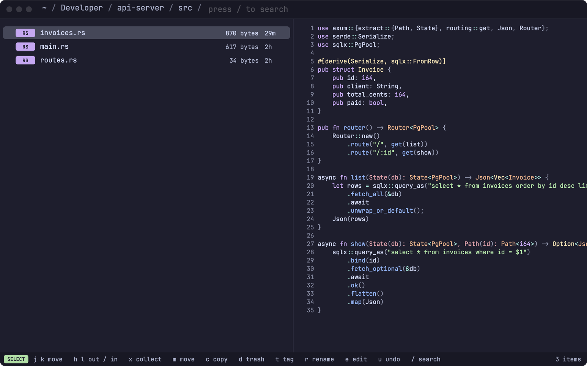

# Using Tilde

The full guide. The [README](../README.md) has the short version; [CONFIG.md](CONFIG.md) covers the config file.

## First launch

A welcome window covers Full Disk Access (with its status, updated as you grant it), asks
for Desktop, Documents and Downloads up front if you'd rather not have macOS ask mid-search,
picks the editor for EDIT, and shows the modes. Help › Welcome to Tilde opens it again.
Run from a terminal instead of as an app, macOS asks about the terminal, and the window
says which one.

## Keys

These are the defaults. Every GO and SELECT key can be changed in Settings › Keys (press
the new key) or in the config file (see [CONFIG.md](CONFIG.md)). The status bar shows the
essentials; **`?`** (`⌃/` while typing in the bar, or a click on the status bar) lists every
key for where you are, with the menu's shortcuts. Type to find one; `⏎` or a click runs it.

| Mode | Keys |
|---|---|
| GO (typing searches) | type to search this folder and everywhere · `↑` `↓` or `⌃j` `⌃k` move · `⏎` open · `tab`, `/` or `⌃l` go into folder (or reveal an Everywhere file) · `⌫` on empty bar or `⌃h` goes up · `~` home · `@` Activity · `⌃o` / `⌃i` back / forward · `esc` → SELECT |
| SELECT | `j` `k` (or `⌃j` `⌃k`) move · `h` `l` (or `⌃h` `⌃l`) out / in · `⏎` open · `g` go to (`g g` top) · `G` bottom · `b` bookmark · `⌃o` / `⌃i` back / forward · a count first repeats a move (`5j`, `2h`, `4x`; `12G` row 12) · `s` sort · `S` reverse · `.` hidden files · `R` read again · `/` → GO · `esc` clear filter, then shelf |
| SELECT: files | `x` add to / remove from shelf · `a` all shown · `y` copy (yank) · `p` paste · `P` paste, moving · `m` move to… · `c` copy to… · `d` trash · `t` tags · `space` preview · `w` open with · `r` rename · `n` new folder · `z` compress · `Y` copy paths · `u` undo · `U` or `⌃R` redo · `H` history · `C` Clean Up · `X` hide from search |
| Views (preview, History, Clean Up, Activity) | `esc` or `h` backs out one layer · the key that opened a view closes it · `q` closes any of them |
| Activity (`@`, again or `⌫` to go back) | `1` all · `2` downloads · `3` screenshots · `4` edited · `5` AirDrop · `i` inbox only · `tab` reveal in its folder · file actions as in SELECT |
| EDIT (the folder as text) | `e` edit the folder · `r` rename (cursor on the name, `⏎` applies) · `o` new line below (`⏎` applies) · `⌘S` apply · `esc` discard (twice if changed) · in Neovim: `:w` apply, `:q` discard, `⌘.` cancel |
| Anywhere (as in the Finder) | `⌘C` / `⌘V` copy and paste files · `⌥⌘V` move them here · `⌘↑` enclosing folder · `⌘↓` or `⌘O` open · `⇧⌘H` Home · `⌥⌘L` Downloads · `⇧⌘D` Desktop · `⇧⌘O` Documents · `⇧⌘A` Applications · `⇧⌘C` Computer · `⇧⌘F` Activity · `⇧⌘G` go to folder · `⌥⌘Z` History · `⌘Y` Quick Look · `⌘[` / `⌘]` back / forward · `⌘Z` / `⌘⇧Z` undo / redo · `⌘⌫` trash · `⌘.` stop a running operation · `⌘⇧N` new folder · `⌘⇧.` show hidden files · `⌘⇧I` search index · `⌘N` new window · `⌘,` settings · `⌥⌘,` open config file · `⌘R` reload config |



File actions apply to the shelf when it has anything, otherwise to the highlighted row.
Move and copy open a folder picker: type to fuzzy-search folders (the folders you use most
show first), or type a path like `~/Documents/`. If something with the same name is
already there, Tilde asks: `k` keep both (`report 2.pdf`, like the Finder), `r` replace (the
old one goes to the Trash, and undo brings it back) or `s` skip. Copies on the same disk
are instant APFS clones; copies to another disk show progress in bytes and can be stopped
with `⌘.` (the partial copy is removed). Trashed items can be put back with undo or from
the Finder.

**Drag and drop.** Drag a row to another app (Finder, Mail, a browser's upload area): it
always arrives as a copy, so nothing moves without Tilde knowing. Drag a shelved row and
the whole shelf goes. Drop files onto the list to bring them into the open folder, or
onto a folder row to put them in that folder: a move on the same disk, a copy to another
(hold ⌥ to copy). Drops ask about name clashes and undo like any move.

<picture>
  <source media="(prefers-color-scheme: light)" srcset="images/browse-light.png">
  
</picture>

**The preview pane** is instant: a thumbnail rendered for the pane (images, the first
page of PDFs and documents, a frame of video), the icon and details for files without
one, bat for code and text (highlighted, with line numbers, the first `max_lines`),
Markdown rendered as text, Quick Look's view for folders and apps. The full, interactive
preview (every page of a PDF, video playback, zoom, the whole of a code or text file in a
larger font, Markdown rendered like GitHub with tables, images and maths, HTML pages
rendered with their own styles but no scripts and nothing fetched) comes on request with
`space`. To make that
quick, it's loaded invisibly once you rest on a file for a moment, and dropped when you
move on; so `space` usually shows it at once. That background load is skipped where it would
cost something: files only in iCloud (they'd be downloaded), on network drives, video and
audio, and anything over 50 MB. Those load when you press `space`, with a spinner.

**File dialogs.** Turn on Settings › General › File dialogs (or `[dialog] enabled = true`)
and give Tilde the Accessibility permission. Then, in any app's Open or Save dialog,
press `⌃⌥Space` (change it in Settings or `[dialog] hotkey`): Tilde's search opens over
the dialog, with the folder open in Tilde first. Pick a folder and the dialog goes
there; pick a file and an Open dialog selects it (`confirm = true` also presses Open),
while a Save dialog goes to its folder and keeps the name you typed. It works with
dialogs that use the standard macOS panel (most apps and browsers); apps with their own
pickers aren't supported. You can also drag from Tilde onto any dialog.

<picture>
  <source media="(prefers-color-scheme: light)" srcset="images/preview-light.png">
  
</picture>

**Quick Look and Open With.** `space` toggles **PREVIEW**, as in the Finder: the full preview fills 75% of the
window (`[preview] mode_width`, or Settings › Preview) and has the keyboard, so `j` / `k`
scroll, `⌃d` / `⌃u` (or `⌃f` / `⌃b`, `⇟` / `⇞`) page and `g g` / `G` jump to the top or bottom; `f` gives it the
whole window, hiding the list, and `f` again brings the list back (`f` from the list goes
straight there). `v` swaps a rendered view (Markdown, HTML, an SVG…) for the file's whole
source, highlighted by bat, and `v` again swaps back; from the list, `v` goes straight to
the source. `space` again, `esc`, `h`, `q` or a click on the list goes back. PDFs,
code, text and Markdown scroll in small steps; documents Quick Look draws (Office, Pages
and so on) move a page at a time, since Quick Look only takes page keys. `⇧space` (or `⌘Y`) opens the
Quick Look window; with items on the shelf, or the preview pane turned off, `space` opens it
too. `w` lists the apps that can open the item, your default first; type to narrow it down.
Right-click a row for Open, Open With, Quick Look, Show in Finder, Copy Path, Tags, Rename
and Move to Trash. The shelf is kept when you quit, and comes back in the first window.

`t` edits Finder tags as a comma-separated list (`Work, Red`; colour names show in colour
in the Finder). With several items it shows the tags they share: removing one removes it
from all of them, adding one adds it to all, and their other tags stay. Tags show under the
preview.

**History** (`H`, or Edit › History… `⌥⌘Z`) shows the undo tree in place of the list:
every operation is a node, newest at the top, on the branch it was done on, down to a
**Start** node. Undoing something and then doing something new starts a new branch; the
old one stays (struck through) and can be returned to. The current state is ringed and
marked **now**. The side shows what the selected operation did and what each key would do:

- `⏎` puts files back the way they were right after that operation, across branches:
  everything not on its line is undone (newest first), and what's missing on its line is
  redone (oldest first). Use **Start** to go back before everything.
- `u` undoes just that operation. Later operations that touched the same files (or
  things inside a folder it touched) are undone first, newest first, so nothing is left
  half-reverted.
- `U` (or `⌃R`) redoes it, after redoing the undone operations it builds on.

Anything involving more than one operation lists them and asks first. If something
outside Tilde got in the way (a file moved again, a name now taken), the run stops there
and says why; what was done so far stays recorded. `u` / `⌘Z` and `U` / `⌘⇧Z` move back
and forward along the current branch. `j` / `k` move, `esc`, `h`, `q` or `H` goes back. The history is
shared by all windows and kept across restarts (the last 200 operations from the past 30
days, in `~/Library/Application Support/Tilde/undo.json`).

**Clean Up** (`C`, or View › Clean Up…) suggests what could go, in place of the list
(the preview stays beside it), with the free space on the disk at the top:

- **App caches** in `~/Library/Caches` (Apple's own are left alone). Apps rebuild them.
- **Duplicates**: files with the same contents, at least 1 MB. One copy per set is marked
  **keep** (one outside Downloads, the Desktop and caches; then the oldest) and can't be
  trashed. Likely sets show within a second or two; the contents are then checked in
  full, biggest first ("checking…" until then). Hashes are cached, so looking again is
  quick. Clones (APFS copies that share their space) are counted as freeing nothing.
- **Big files you haven't opened**: 500 MB or more, not opened or changed in 6 months.
- **Old downloads**: in Downloads or on the Desktop for over 60 days; installers
  (`.dmg`, `.pkg`) are marked, with the site they came from.
- **Build output in idle projects**: `node_modules`, `target`, `.venv`… in projects
  (a folder with `.git`, `package.json`, `Cargo.toml`…) nothing has changed in for 90 days.
- **Trash**: what's in it.

<picture>
  <source media="(prefers-color-scheme: light)" srcset="images/cleanup-light.png">
  
</picture>

It looks in the background, from the search index plus a measuring pass, so the page
opens at once and fills in. `j` / `k` move, `l` or `⏎` opens a category, `h` or `⌫` goes
back, `1`–`6` open a category by its number (shown beside it), `R` looks again, `esc`, `q` or `C` closes. In a category: `x` collects an item on the
shelf, `a` collects all of them, `d` trashes (the collected items, or the highlighted
one), `m` moves, `X` never suggests it again, `space` previews, `⏎` shows it in its folder.
Before trashing, each item is checked to still be what was suggested (same size and
date; for a duplicate, still identical to the copy kept), and a running app's cache is
left alone. Everything goes to the Trash and can be undone, except emptying the Trash
(`d` in the Trash category), which asks first. In Low Power Mode the duplicate check is
skipped until you press `R`. Settings › Clean Up (or `[cleanup]`) has the thresholds.

While typing in the bar, `⌘⌫` and `⌃⌫` clear what's typed; Move to Trash (`⌘⌫`) only
works from the list in SELECT.

`⌃o` goes back to where you were before, like Vim's jump list or a browser's Back:
the folder you came from (not necessarily the parent), with what you'd typed in the bar
and the item you had highlighted, so the same view comes back; or Activity. `⌃i` goes forward again. Every move counts (into a folder, up, `~`, a reveal
from Everywhere, `@`), and a new move after going back drops the forward history. Each
window keeps its own list.

`s` sorts the folder: then `n` name, `m` date modified, `a` date added, `s` size or `k`
kind (by extension); picking the current order again reverses it. Also View › Sort By
(`⌃⌘1`–`⌃⌘5`). The order applies to every folder you open, and is kept for next time
(it's saved as `[sort] by` and `reverse`); the status bar shows it when it isn't by name.
To have each folder keep its own order instead (Downloads by date added, a project by
name), turn off Settings › General › Sort every folder the same way. Folders stay on top;
a size sort orders them by their size once it's measured (see Folder sizes), by how many
items they hold before. Typing a search ranks by match, while
filters like `ext:pdf` keep the folder's order. Sorting by date added shows when items
arrived instead of when they changed.

Filters: `ext:pdf`, `kind:image`, `mod:<7d`, `size:>100M`, `in:dev` (path contains), `in:.` (this folder and below), `text:` (inside files, below), `text!:` (inside ignored files too).

**Inside files.** `text:launch`, or `text:"launch window"` for a phrase, searches what files
say rather than their names. The results replace the list, under **In files**, each with
its first matching line (the match highlighted), its line number and how many times it
matches; the preview opens there with the line highlighted, and `space` shows the whole
file at that spot. Other terms and filters narrow it: `ship text:warp ext:rs`. A capital
in the text makes it case-sensitive.

Nothing is read until you type `text:` and three characters, and there's no index of
file contents, so ordinary searching costs nothing extra. Then, after a moment's pause in
typing, Tilde reads the open folder and everything under it, skipping `.gitignore`d
files, build folders (`node_modules`, `target`…, the Clean Up list), `.git`, hidden files
(unless shown), binaries and files over 2 MB; it stops after 20,000 files, and every new
keystroke cancels it. Beyond the folder it asks Spotlight, which also knows PDFs and
documents, when Spotlight is indexing; if it isn't (or Settings › Search says not to), Tilde
reads up to 4,000 recently changed text files from its own index instead. The status bar
says what was searched. Settings › Search turns it off, or Spotlight's part.

**Everything.** `text!:launch` reads the folder without skipping anything: `.gitignore`d
files, build folders and hidden files too (only `.git`, binaries and files over 2 MB are
still left out). Handy for generated code, logs or a dependency's source; slower in a big
project, since `node_modules` and friends count towards the 20,000 files.

## Maths

Markdown previews (`space`) typeset maths with [KaTeX](https://katex.org), as in Obsidian,
GitHub and Jupyter:

- `$…$` inline and `$$…$$` display, including blocks over several lines with blank lines
  or lines starting with `-`, `+` or `>` inside (`aligned` steps), in quotes, callouts,
  lists and table cells. `$5 and $10` stays text, as does anything in code.
- `\( … \)` and `\[ … \]` (on lines of their own), ```` ```math ```` blocks and
  GitHub's `` $`…`$ ``.
- `align`, `cases`, `bmatrix`, `array`, `gather`, `alignat`, commutative diagrams
  (`CD`), chemistry (`\ce{…}`), colours, `\cancel`, `\boxed`, and the rest of
  [what KaTeX supports](https://katex.org/docs/supported). Equations aren't numbered
  unless they have a `\tag{…}`, as in Obsidian.
- `\newcommand`, `\def` and `\DeclareMathOperator` hold for the rest of the note.

A formula KaTeX can't render shows as its TeX in red, with the error when you hover over
it; the rest of the note renders. What doesn't work: `\label` and `\eqref`, siunitx,
TikZ, the physics package's `\dv`/`\qty`, and `\href` or `\includegraphics` (turned
off so a note can't link out or load anything). The pane's quick preview shows maths as
its TeX.

## Going places, bookmarks, copy and paste

**`g`** lists where it can take you, each a key away: `g h` Home, `g d` Downloads, `g D`
Desktop, `g o` Documents, `g A` Applications, `g i` iCloud Drive, `g t` Trash, `g v`
Volumes, `g /` the whole disk; `g a` Activity, `g c` Clean Up, `g u` History; and `g g` the
first item of whatever is showing (the list, a preview, History). The Go menu has the same
places with the Finder's shortcuts (`⇧⌘H`, `⌥⌘L`, `⇧⌘D`…), plus Enclosing Folder (`⌘↑`)
and Go to Folder… (`⇧⌘G`, the folder picker).

**Bookmarks**: in a folder, `b` and then a key bookmarks it, and `g` with that key goes
back to it from anywhere. The keys `g` already uses are taken. `b` and a key in use
moves that bookmark to this folder; on its own folder, it removes it. Bookmarks show at the
bottom of the `g` list.

**Copy and paste**, Vim style and Finder style: `y` (or `⌘C`) copies the highlighted
item, or the shelf, as the Finder copies files; `p` (or `⌘V`) pastes copies into the open
folder, and `P` (or `⌥⌘V`) moves them here instead. It works across apps: copy in the
Finder and paste in Tilde, or copy in Tilde and paste into a mail. Pasting into the same
folder makes copies (`report 2.pdf`); names that clash elsewhere ask first. Everything is
undoable.

## Archives

A zip, tar (`.tar.gz`, `.tgz`, `.tar.bz2`, `.tar.xz`…), 7z, rar, xar, cpio or ISO opens
like a folder: `l` (or `tab`) goes in, `h` comes back out, and its folders show their sizes.
`⏎` still opens the archive itself (Archive Utility unpacks it). Documents that are zips
inside, like `.docx` or `.key`, aren't treated as archives.

Inside, everything previews (each file is unpacked on its own when it's highlighted, kept in
`~/Library/Caches/Tilde/Archives` for a few days), and `⏎`, Quick Look and Open With work.
Archives are read-only: copy files out with `c` (to a folder you pick) or `y` and then `p`
where you want them, or drag them out. Moving, renaming, trashing and editing inside an
archive aren't possible. Searching inside files (`text:`) doesn't look in archives.

## Folder sizes

Folders show their total size instead of an item count, and sorting by size (`s s`) sorts
them by it, as soon as they've been measured. Measuring happens in the background, at low
priority: the folders you're looking at are measured, a couple of levels inside them are
remembered too (so going in shows sizes at once), and everything is saved for the next
launch. A size is measured again when something inside changes, but not too often for big
folders: one that took a second to measure waits at least 20 seconds, one that took a
minute, 20 minutes. Volumes mounted inside a folder aren't counted. Turn it off in
Settings › General (`[sort] folder_sizes`).

## From the terminal

The `tilde` command opens Tilde: `tilde` on the current folder, `tilde ~/Downloads` on a
folder, `tilde notes.md` on a file's folder with the file highlighted. Homebrew puts it on
your `PATH`; otherwise it's inside the app (Settings › General has the line to link it).

`tilde --cd` also waits: when the window closes, it prints the folder the window was on.
`tilde init zsh` (or `bash`, `fish`) prints a shell function `t` that uses it to take the
terminal there:

```sh
eval "$(tilde init zsh)"     # in ~/.zshrc; ~/.bashrc with bash
tilde init fish | source     # in ~/.config/fish/config.fish
```

Then `t` opens Tilde where you are; find your way somewhere, press `q` (or `⌘W`, or quit
Tilde), and the terminal is back in front, in that folder.

## Using the mouse

Everything has a key, and nothing below changes them; it's there for when your hand is
on the mouse:

- **Click a folder in the path bar** to go there. Drop files on it to move them there
  (copy with ⌥ held, or to another disk), as a drop on the list does.
- **`⋯` on the row under the pointer** (it shows only while the mouse moves over the list,
  and goes at the first key press) opens the row's actions, as a right-click does: open,
  open with, preview, source, Quick Look, show in Finder, shelf, move to…, copy to…,
  rename, tags, compress, copy path, trash. With items on the shelf, file actions apply to
  the shelf, as their keys do.
- **Right-click empty space** for the folder: new folder, edit as text, sort, hidden files,
  open in Terminal, show in Finder, copy path, Clean Up.
- **⌘-click** a row to put it on the shelf or take it off; **⇧-click** to shelve every row
  from the highlighted one to the clicked one.
- **Click the status bar**: on the left for the list of keys, on the right (the item count)
  for the sort order, hidden files, and a jump to the Everywhere results.
- **Hold a dragged file over a folder** and the folder opens, as in the Finder.

## Search

<picture>
  <source media="(prefers-color-scheme: light)" srcset="images/search-light.png">
  
</picture>

Typing shows matches in the current folder first, then an **Everywhere** section from an
index of your home folder. The first launch builds it in the background (the status bar
shows progress); after that it's saved to `~/Library/Caches/Tilde/index.bin` and loaded at
launch, with FSEvents replaying whatever changed while Tilde was closed. While Tilde runs,
changes are picked up as they happen. It skips `~/Library`, hidden files, `node_modules`,
`.git` and similar folders, and doesn't cross into other disks or mounts. The open folder
also refreshes by itself when its contents change.

**Search Index window (`⌘⇧I`):** item count against the limit, memory, size on disk, and the
folders holding the most items, each with **Exclude contents** (keep the folder, skip what's
inside) and **Hide** (leave it out). **Rebuild** re-reads the config and indexes again;
**Clear** deletes the saved index and turns Everywhere off until you rebuild. In SELECT,
`X` hides the highlighted item. Exclusions are written to the config, so you can undo them
there.

Results you use rank higher. Tilde keeps its own frecency: each folder you open and each
file you open from Tilde (`⏎`, Open With, a file-dialog pick) or pick as a move or copy
destination earns a score, which halves every 10 days without use, so what you use now
beats a habit you've dropped. A folder you only pass through on the way somewhere (left
within two seconds) barely counts. Folders you use that the index doesn't cover (hidden
or excluded ones) become searchable too. If [zoxide](https://github.com/ajeetdsouza/zoxide)
is installed, its scores count as well (re-read every minute), so folders you use in the
terminal rank high too; `tell_zoxide` also sends Tilde's folder visits to zoxide. Scores
live in `~/Library/Application Support/Tilde/frecency.json`; configure under `[frecency]`.

## Editing a folder as text

`e` turns the folder into text, one line per item (folders end with `/`):

- edit a name to **rename**
- delete a line to **trash** it
- change a line to a path (`archive/x.pdf`, `~/Documents/x.pdf`) to **move** it
- duplicate a line to **copy** it
- add a line to **create** a file, or a folder if it ends with `/`

Each line carries a hidden ID, so reordering, cut and paste keep track of which item is
which. The side pane lists what will happen as you type, and lines with problems (a name
that's taken, a bad character) are tinted. `⌘S` applies everything as one operation, and
`u` undoes all of it.

### In Neovim

Set `editor = "nvim"` under `[edit]` and EDIT runs your Neovim (0.10 or later) inside
Tilde, with your own config. It starts on the first edit and stays running for the next
ones.

- `:w` (or `⌘S`) applies, `:q` / `:q!` / `ZQ` discards, `:wq` and `ZZ` apply. `⌘.` cancels
  from any mode.
- `r` and `o` start in insert mode (the name's stem selected for `r`); `⏎` applies.
- The IDs are concealed and the cursor is kept out of them. `yyp`, `dd`, `p` and macros all
  work, since lines carry their IDs.
- Lines with problems show as diagnostics; a write with problems is refused with a message
  and the buffer stays open.
- The buffer has `filetype=tilde`, so a `FileType tilde` autocommand can turn off
  format-on-save or anything else that gets in the way. Changing a line with `cc` or `S`
  drops its ID (it becomes a new file, and the old one is trashed).
- `nvim_path` picks a specific nvim; otherwise Tilde looks on your login shell's `PATH`, then
  in Homebrew's folders. `nvim_config = "clean"` skips your config and loads
  `~/.config/tilde/init.lua` instead, if it exists.
- If nvim can't be found, EDIT says why and uses the built-in editor.

## Activity

<picture>
  <source media="(prefers-color-scheme: light)" srcset="images/activity-light.png">
  
</picture>

`@` shows what arrived or changed recently: downloads (with the site they came from),
screenshots and screen recordings, AirDrops, and files you created or edited, newest first
under Today / Yesterday / This week / This month / Earlier. It covers everything in your
**inbox folders** (Downloads, the Desktop and wherever screenshots are saved) plus files
anywhere in the index changed in the last 30 days. `i` narrows it to what's still in an
inbox folder; move things out with `m` (or trash them with `d`) and they leave the inbox.
Downloads that live somewhere else now are marked **filed**.

Nothing is logged: origins come from the attributes macOS attaches to files, so the feed
has history from the first launch and counts moves made in the Finder too. Configure the
inbox folders and how far back it goes under `[activity]`.
